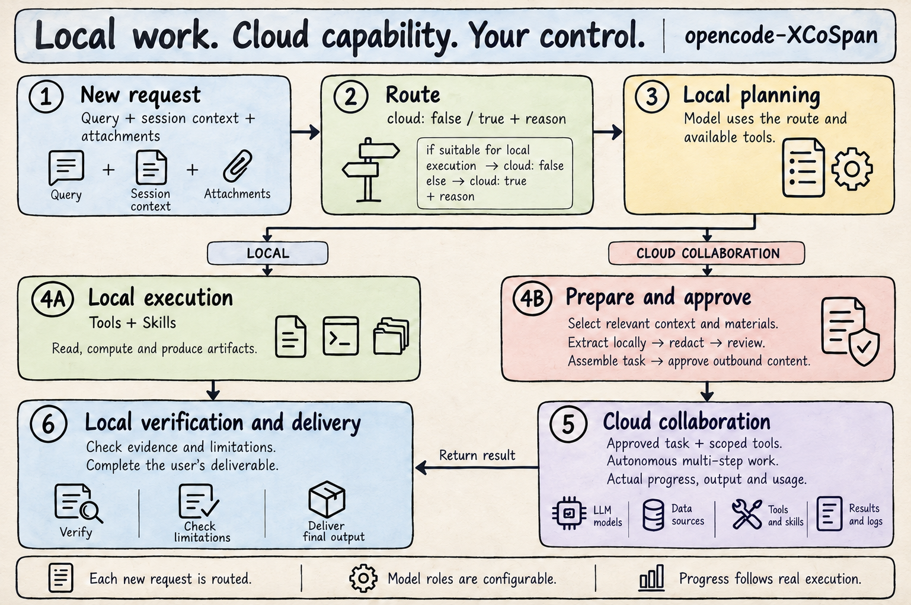
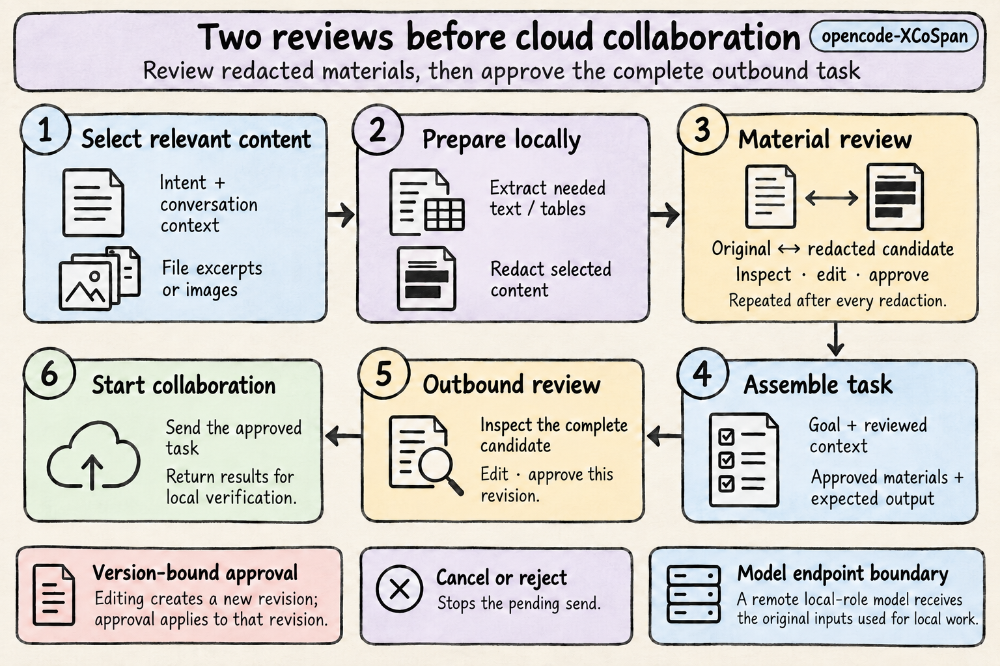

# opencode-XCoSpan

**Local execution and reviewed cloud collaboration for OpenCode.**

[](https://github.com/XHToken/opencode-XCoSpan/actions/workflows/check.yml?query=branch%3Amain)
[](https://opencode.ai)
[](LICENSE)



XCoSpan connects routing, redaction, user review, cloud collaboration, and result delivery in OpenCode V2. The local model plans the task, uses tools and Skills, and selects relevant materials. Cloud tasks run after the user approves their outbound content.

| Collaborate on demand                                    | Review what leaves                                             | Follow actual progress                                             |
| -------------------------------------------------------- | -------------------------------------------------------------- | ------------------------------------------------------------------ |
| Route each new request; let the model choose its actions | Edit redacted materials and approve the complete outbound task | Inspect real execution, cancel work, and recover completed results |

[Quick start](#quick-start) · [Review and control](#review-and-control) · [Configuration](docs/CONFIGURATION.md) · [Contributing](CONTRIBUTING.md)

## Quick start

Requires **OpenCode 2.0.27**, **Bun 1.4.3**, Git, and read access to this repository. XCoSpan uses your OpenCode provider accounts and model catalog. Install Bun through the [Bun installation guide](https://bun.sh/docs/installation).

Windows users can follow these commands in PowerShell. See [platform and provider compatibility](docs/COMPATIBILITY.md) for native Windows, material extraction, and credential setup.

**1. Install the plugin**

Run in your terminal:

```sh
git clone --depth 1 --branch main https://github.com/XHToken/opencode-XCoSpan.git
cd opencode-XCoSpan
bun install --frozen-lockfile
bun run setup
```

The setup command builds the plugin and registers this checkout in your global OpenCode configuration. Existing provider accounts and workspace settings are retained. Keep the checkout at this location; OpenCode loads the plugin from it. Authenticate Git with your GitHub account to access the private repository.

**2. Open your workspace**

Reopen OpenCode after installation. From the directory where you want to work, run:

```sh
opencode
```

**3. Choose models and start**

Enter `/xcospan` in the OpenCode conversation, then follow the interface:

```text
Configure models
  → Choose the local model
  → Choose the cloud model
  → Test connection and tool calling
  → Save and start
  → Confirm model roles and choose the default for new sessions
```

Reuse accounts and models configured in OpenCode. To add an account, select **Connect an account /connect**, finish connecting, then return to `/xcospan`. Use **Add a local or custom provider** for your own endpoint. Both roles require tool calling and may use the same model. Connection tests send requests to the selected providers and incur usage.

Send your task normally once XCoSpan starts. Review each redaction and the complete outbound task when prompted. For later sessions, open `/xcospan` and select **Start**, or choose **Use XCoSpan by default** during setup.

> A remote provider configured for the local role receives original task inputs and local tool results. Protocols, credentials, and model limits come from OpenCode provider configuration. See [configuration](docs/CONFIGURATION.md) and [data boundaries](SECURITY.md).

## Review and control



**After every redaction**, inspect the original and candidate side by side. **Before cloud execution**, review the complete outbound task. Both reviews support editing, approval, and cancellation. Edits create a new revision; approval applies to that revision. Cancelling a review stops the current task, including concurrent pending reviews. Send a new request when you want to continue.

The sidebar displays operations, targets, recent output, and elapsed time from execution events. Use `/xcospan-status` in a narrow terminal. Missing usage or pricing is shown as unknown. Routing and redaction usage is excluded from the displayed totals.

| Command            | Purpose                                                                                 |
| ------------------ | --------------------------------------------------------------------------------------- |
| `/xcospan`         | Configure models, start, return to the previous agent, stop, disable, enable, or remove |
| `/xcospan-review`  | Open pending reviews                                                                    |
| `/xcospan-status`  | Inspect progress, models, and usage                                                     |
| `/xcospan-cancel`  | Select and cancel a cloud task                                                          |
| `/xcospan-recover` | Check and recover delivery of a completed result                                        |

Use `/xcospan` → **Stop the current task** to interrupt the current session's work. **Return to the previous agent** resumes your previous agent and model; a session started directly in XCoSpan offers **Choose another agent**. **Disable collaboration** stops related work and retains model configuration; **Enable collaboration** makes it available again.

**Remove plugin** removes the entry from the selected configuration source. Model accounts, conversation history, reviews, and user files remain available. Deleting an OpenCode conversation removes its associated XCoSpan reviews and run records; deletions made while the plugin is unloaded are reconciled when it loads again. Check `/plugins` if another configuration source still loads XCoSpan.

<details>
<summary>Review shortcuts and supported materials</summary>

- **Edit and approve:** Ctrl+E to edit, Tab / Shift+Tab to change fields, Ctrl+S to save, Ctrl+A to approve, Ctrl+X to cancel.
- **Compare and inspect images:** Ctrl+D switches comparison views. Ctrl+O opens the image viewer; arrow keys pan, `=` / `-` zoom, and `0` fits the viewport.
- **Local materials:** the bundled `xcospan-materials` Skill guides task-driven selection of text, tables, and visual content. Its extraction helper uses [Xberg](https://github.com/xberg-io/xberg/tree/main/crates/xberg-node) for documents, spreadsheets, presentations, PDFs, markup, email, and other supported formats; `--formats` lists the installed engine's registry.
- **Scans and calculations:** OCR uses explicitly selected local Tesseract language data. Spreadsheet calculations and visual interpretation use suitable local tools. Extraction preserves source references and engine warnings for inspection.
- **Image redaction:** requires a configured local service. See the [capability service contract](docs/CONFIGURATION.md#redaction).

</details>

## Update or uninstall

For the checkout installation above, run these commands from its directory:

```sh
git pull --ff-only origin main
bun install --frozen-lockfile
bun run build
```

Stop active work before updating, then reopen OpenCode. To uninstall, open `/xcospan` and select **Remove plugin** for the registered checkout. Check `/plugins` to confirm removal before deleting the checkout directory.

<details>
<summary>Registry installation</summary>

Registry installation requires a published version of `@iflytekopensource/opencode-xcospan`. Check availability before installing:

```sh
npm view @iflytekopensource/opencode-xcospan version
opencode plugin add @iflytekopensource/opencode-xcospan
```

Remove an existing checkout entry through `/xcospan` before adding the registry package. Manage registry installations with:

```sh
opencode plugin check @iflytekopensource/opencode-xcospan
opencode plugin update @iflytekopensource/opencode-xcospan
opencode plugin remove @iflytekopensource/opencode-xcospan
```

Use the exact configured package specifier if you installed a version or tag. Stop active work before updating, then reopen OpenCode.

</details>

## Documentation and contributing

| Document                               | Contents                                                      |
| -------------------------------------- | ------------------------------------------------------------- |
| [Configuration](docs/CONFIGURATION.md) | Model setup, routing, and redaction service contracts         |
| [Architecture](docs/ARCHITECTURE.md)   | Execution flow, module responsibilities, and host integration |
| [Contributing](CONTRIBUTING.md)        | Development setup, checks, and change guidelines              |
| [Testing](test/README.md)              | Unit, native host, and real-model validation                  |
| [Security](SECURITY.md)                | Data access and deployment boundaries                         |
| [Code of Conduct](CODE_OF_CONDUCT.md)  | Community standards and reporting                             |
| [Changelog](CHANGELOG.md)              | User-visible changes and release history                      |
| [Compatibility](docs/COMPATIBILITY.md) | Supported platforms, providers, protocols, and authentication |
| [Releasing](docs/RELEASING.md)         | Package verification and release procedures                   |

The npm package includes documentation and diagrams. Report issues and propose changes on [GitHub](https://github.com/XHToken/opencode-XCoSpan).

[MIT License](LICENSE)
