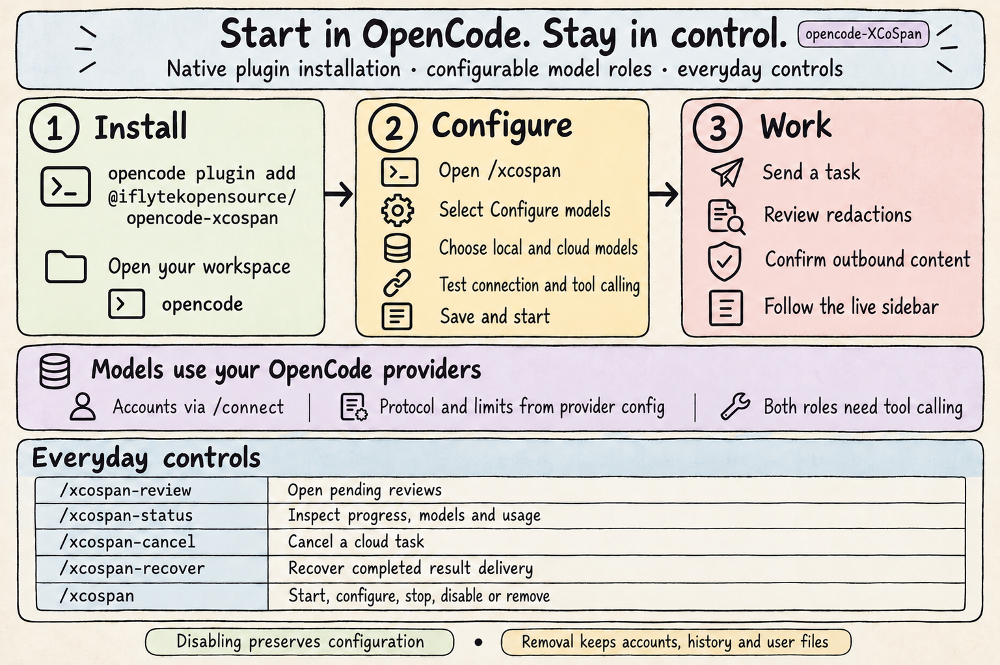

# opencode-XCoSpan

> Local–cloud collaboration for [OpenCode](https://opencode.ai) — Per-request Routing, Local Redaction, Editable Review, Approved Cloud Tasks, and Live Progress.

[](https://github.com/XHToken/opencode-XCoSpan/actions/workflows/check.yml?query=branch%3Amain) [](https://opencode.ai/v2/docs/build/plugins) [](package.json) [](https://bun.sh/docs/installation) [](CONTRIBUTING.md) [](https://github.com/XHToken/community/blob/main/LICENSE) [](https://github.com/XHToken/community#contact)

XCoSpan brings **local execution and reviewed cloud collaboration into one OpenCode session**. Choose your local and cloud models through `/xcospan`, then send tasks normally. Each new request is routed; the local model plans the work, uses tools and Skills, and prepares any cloud task for your review. Approved work returns to the local model for verification and delivery.

[Installation](#installation) · [Quick start](#quick-start) · [Architecture](#architecture) · [Features](#features) · [Review and control](#review-and-control) · [Commands](#commands) · [Documentation](#documentation-and-contributing)

## Architecture

<p align="center">
  
</p>

The local model selects the task's tools, context, and materials. XCoSpan connects routing, redaction, review, delegation, and result delivery through OpenCode's native sessions and interfaces. Cloud execution begins after approval of the complete outbound task.

## Features

### Routing and execution

- **Per-request routing** — assess each new query using recent conversation context and available local capabilities. Choose local execution or cloud collaboration.
- **Flexible local planning** — let the model select tools, Skills, relevant materials, and the sequence of actions required by the task.
- **Independent model roles** — choose local and cloud models from OpenCode's provider catalog. Protocols, credentials, and model limits follow native provider configuration.

### Redaction and review

- **Local material preparation** — extract relevant text and tables from documents, spreadsheets, PDFs, presentations, and other supported formats.
- **Editable redaction review** — inspect the original and candidate after every redaction; edit and approve the content that may be used for collaboration.
- **Complete outbound approval** — review the assembled task and materials before cloud execution. Approval is bound to the candidate revision.

### Progress and control

- **Live execution visibility** — follow actual operations, targets, recent output, elapsed time, and available usage in the sidebar.
- **Cancellation and recovery** — stop active work or recover delivery of a completed cloud result from persisted records.
- **Native setup and lifecycle** — configure models, start, stop, disable, enable, and remove XCoSpan through `/xcospan`.

## Installation

| Component           | Requirement                                |
| ------------------- | ------------------------------------------ |
| OpenCode            | **2.0.27**                                 |
| Material extraction | **Bun 1.4.3** on the PATH used by OpenCode |

Install the npm package through OpenCode's plugin manager:

```sh
opencode plugin add @iflytekopensource/opencode-xcospan
```

The command installs the plugin and adds it to your global OpenCode configuration. Reopen OpenCode after installation. Windows users can run the same command in PowerShell.

Install Bun using the [official guide](https://bun.sh/docs/installation) to use the bundled material extraction helper. See [Compatibility](docs/COMPATIBILITY.md) for operating systems, extraction binaries, OCR, and provider authentication. Source installation and development are covered in [Contributing](CONTRIBUTING.md).

## Quick start

After [installation](#installation), configure your models and send a task in OpenCode.

### 1. Open your workspace

Reopen OpenCode after installation. From the directory where you want to work, run:

```sh
opencode
```

### 2. Choose models

Enter `/xcospan` in the conversation and follow the interface:

```text
Configure models
  → Choose the local model
  → Choose the cloud model
  → Test connection and tool calling
  → Save and start
  → Confirm model roles and choose the default for new sessions
```

| Setup action             | Where to find it                                                               |
| ------------------------ | ------------------------------------------------------------------------------ |
| Use an existing provider | Choose its model from the OpenCode catalog                                     |
| Connect an account       | Select **Connect an account /connect**, then return to `/xcospan`              |
| Add your own endpoint    | Select **Add a local or custom provider**                                      |
| Enable future sessions   | Select **Use XCoSpan by default**, or open `/xcospan` → **Start** in a session |

Both model roles require tool calling and may use the same model. Connection tests send requests to the selected providers and incur usage.

### 3. Send a task

Once XCoSpan starts, send your task in the conversation. It routes the request, works locally, and prepares cloud collaboration when needed. Review each redaction and the complete outbound task when prompted, then follow progress and receive the result in the same session.

> **Model endpoints:** a remote provider assigned to the local role receives original task inputs and local tool results. Choose endpoints according to your data requirements. See [Configuration](docs/CONFIGURATION.md) and [Security](SECURITY.md).

<p align="center">
  
</p>

## Review and control

<p align="center">
  
</p>

### Two review stages

| Stage               | What you review                                                    | Available actions                      |
| ------------------- | ------------------------------------------------------------------ | -------------------------------------- |
| **Material review** | Original content and the redacted candidate, after every redaction | Compare, edit, approve, or cancel      |
| **Outbound review** | The complete task, related context, materials, and expected output | Edit, approve this revision, or cancel |

Edits create a new revision; approval applies to that revision. Cancelling a review stops the current task, including concurrent pending reviews. Send a new request when you want to continue.

### Follow the work

The sidebar reflects actual execution events: operations, targets, recent output, elapsed time, and available usage. Open `/xcospan-status` to inspect the same process in a narrow terminal. Missing usage or pricing is shown as unknown; routing and redaction usage is excluded from the displayed totals.

<details>
<summary>Keyboard shortcuts</summary>

| Action                    | Shortcut                       |
| ------------------------- | ------------------------------ |
| Edit a candidate          | Ctrl+E                         |
| Move between fields       | Tab / Shift+Tab                |
| Save edits                | Ctrl+S                         |
| Approve / cancel          | Ctrl+A / Ctrl+X                |
| Switch comparison views   | Ctrl+D                         |
| Open the image viewer     | Ctrl+O                         |
| Pan / zoom / fit an image | Arrow keys / `=` and `-` / `0` |

</details>

## Commands

| Command            | Purpose                                                 |
| ------------------ | ------------------------------------------------------- |
| `/xcospan`         | Configure models and manage the collaboration lifecycle |
| `/xcospan-review`  | Open pending material and outbound reviews              |
| `/xcospan-status`  | Inspect progress, models, and usage                     |
| `/xcospan-cancel`  | Select and cancel a cloud task                          |
| `/xcospan-recover` | Check and recover delivery of a completed result        |

Inside `/xcospan`:

- **Stop the current task** interrupts the current session's work.
- **Return to the previous agent** restores the previous agent and model. Sessions started directly in XCoSpan offer **Choose another agent**.
- **Disable collaboration** stops related work and retains model configuration. **Enable collaboration** makes it available again.
- **Remove plugin** removes the entry from the selected configuration source. Model accounts, conversation history, reviews, and user files remain available.

Deleting an OpenCode conversation removes its associated XCoSpan reviews and run records. Deletions made while the plugin is unloaded are reconciled when it loads again. Check `/plugins` if another configuration source still loads XCoSpan.

## Working with materials

The bundled **`xcospan-materials` Skill** guides task-driven selection and verification. The model chooses the relevant content and local tools for the task.

| Material                                          | Local preparation                                                                                       |
| ------------------------------------------------- | ------------------------------------------------------------------------------------------------------- |
| Documents, PDFs, presentations, markup, and email | Extract relevant text and source references                                                             |
| Spreadsheets and tables                           | Extract required tables; use local tools for calculations                                               |
| Scanned content                                   | Run OCR with explicitly selected local Tesseract language data                                          |
| Images                                            | Use suitable local tools for visual interpretation; image redaction requires a configured local service |

The extraction helper uses [Xberg](https://github.com/xberg-io/xberg/tree/main/crates/xberg-node); `--formats` lists the installed engine's supported formats. Extraction preserves source references and warnings for inspection. See [Compatibility](docs/COMPATIBILITY.md) for native dependencies and the [redaction service contract](docs/CONFIGURATION.md#redaction) for image support.

## Update or uninstall

Check for updates and update the installed npm package:

```sh
opencode plugin check @iflytekopensource/opencode-xcospan
opencode plugin update @iflytekopensource/opencode-xcospan
```

Stop active work before updating, then reopen OpenCode. Use the exact configured package specifier if you installed a version or tag.

To remove the plugin from global configuration:

```sh
opencode plugin remove @iflytekopensource/opencode-xcospan
```

You can also open `/xcospan` → **Remove plugin** to select the configuration source. Confirm removal in `/plugins` and reopen OpenCode. Model accounts, conversations, and user files remain available. Source checkout updates and removal are described in [Contributing](CONTRIBUTING.md#update-or-remove-a-source-checkout).

## Documentation and contributing

| Document                               | Contents                                                        |
| -------------------------------------- | --------------------------------------------------------------- |
| [Configuration](docs/CONFIGURATION.md) | Model setup, routing, and redaction service contracts           |
| [Architecture](docs/ARCHITECTURE.md)   | Execution flow, module responsibilities, and host integration   |
| [Compatibility](docs/COMPATIBILITY.md) | Platforms, providers, protocols, and authentication             |
| [Testing](test/README.md)              | Unit, native host, and real-model validation                    |
| [Changelog](CHANGELOG.md)              | User-visible changes and release history                        |
| [Releasing](docs/RELEASING.md)         | Package verification and release procedures                     |
| [Security](SECURITY.md)                | Data access, deployment boundaries, and vulnerability reporting |
| [Contributing](CONTRIBUTING.md)        | Development setup, checks, and change guidelines                |
| [Code of Conduct](CODE_OF_CONDUCT.md)  | Community standards and reporting                               |

### Development

From a source checkout:

```sh
bun install --frozen-lockfile
bun run check
bun run build
```

`check` runs type checks, formatting checks, and unit tests. Follow [Contributing](CONTRIBUTING.md) for native host validation and [Testing](test/README.md) for opt-in real-model tests. Report reproducible issues and propose focused changes on [GitHub](https://github.com/XHToken/opencode-XCoSpan/issues).

## Community

XCoSpan is part of the [XHToken community](https://github.com/XHToken/community). Join the [community channels](https://github.com/XHToken/community#contact) for ecosystem discussions. Use this repository's [issues](https://github.com/XHToken/opencode-XCoSpan/issues) for bugs and feature requests, and follow [Contributing](CONTRIBUTING.md) to submit changes.

Contributors follow the [XHToken Code of Conduct](CODE_OF_CONDUCT.md) and sign the [Contributor License Agreement](https://github.com/XHToken/community/blob/main/CLA.md).

## License

Licensed under the [XHToken community license](https://github.com/XHToken/community/blob/main/LICENSE) (Apache-2.0). See [LICENSE](LICENSE) for the full text and copyright notices. Package documentation, diagrams, and community guidance are included in the distribution.
